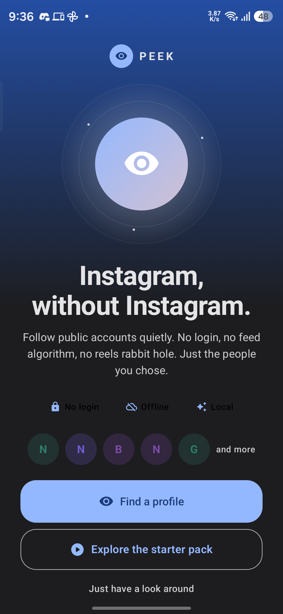
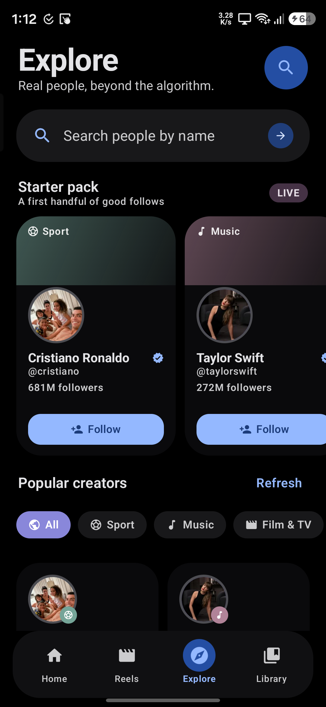
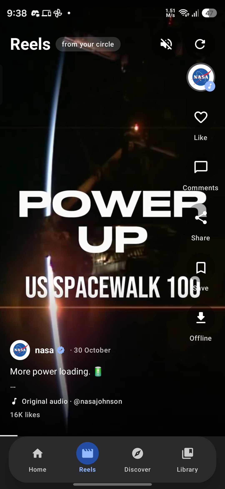
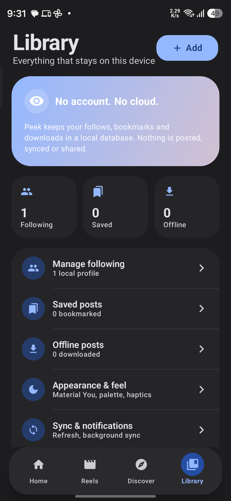

# Peek

**Instagram, without Instagram.**

Peek is a quiet, offline-first viewer for **public** Instagram profiles. Add a username or paste a link, follow that account **locally**, and see their posts and reels in a calm Material You interface. There is no Instagram login, no likes sent to Instagram, no algorithm and no feed suggestions.

> Peek is an unofficial client. It is not affiliated with Instagram or Meta. Only public pages are read. All media belongs to its respective owners.

## Why

Sometimes you just want to see what a few public accounts are sharing, without signing into an app designed to keep you scrolling. Peek keeps the serendipity out and the people in:

- Follow accounts **locally** — nothing is sent to Instagram
- Works **offline** with cached posts, bookmarks and downloads
- **Material You** dynamic colour, AMOLED black, five fallback palettes
- Thoughtful **haptics** and spring animations
- No account, no password, no tracking, no ads

## Features

### Following
- Add by username, `@handle`, or a full `instagram.com/...` link
- **Global search by name** — look for “Cristiano Ronaldo” without knowing `@cristiano`
- Local follow / unfollow, pin favourites to the top of your circle
- Optional searchable overview of everyone in your circle

### Discover & Explore
- Curated **Starter pack** with real avatars, bios and follower counts loaded live
- **Explore popular creators** across Sport, Music, Film & TV, Tech, Nature, Art, Photography, Fashion, Food, Gaming, Travel, Business and Comedy
- Themed **packs** — Museums, Formula 1, Food, Architecture, Photography — plus a **Hidden gems** pack for smaller public accounts
- Import a shared pack from text or JSON; export any pack as a readable list plus a `peek://pack` link
- **Local suggestions** based on the categories you already follow
- Recently viewed profiles, recent searches and suggested names
- Material You category colours, animated cards and one-tap local follow
- Name search falls back to public web discovery; the profile itself is always read directly

### Search
- Search by **name**, `@handle`, or a pasted profile / post / reel link
- Resolve a post or reel link to its author without leaving the app
- **Filters** for category, verified accounts, follower range and country
- **Saved searches and aliases** — teach Peek that "CR7" means `@cristiano`
- **Offline search** across cached bios, usernames and captions
- Official-looking accounts are marked from their public verified badge, never guessed

### Home feed
- A quiet feed of the latest posts from accounts you follow
- Story-style avatar strip with unread rings and a count badge in the navigation bar
- Filters for **All / Photos / Reels / Videos**
- Double-tap to like with a particle heart burst and haptics
- Local liked feed, bookmarks and "save offline" downloads
- Pull to refresh; cached content opens instantly

### Profiles
- Full profile header with avatar, bio, links, stats and highlights
- Posts and Reels tabs, plus bookmarks saved from that profile
- **More like this** — related public creators from the same category, with local follow
- **See every public post** with automatic grid pagination and a “Load more posts” fallback
- **Download profile** in one action: Peek walks every public timeline page, then saves all posts offline, with an option to copy every photo and video into the device gallery
- Public/private state is re-checked on refresh and never inferred from an empty grid
- Local saved state shown on the grid
- Share, copy, open on Instagram, pin, unfollow or remove a profile
- Shared-element avatar transition from your Home circle into the profile header

### Posts & reels
- Full-screen post viewer with carousel paging and **swipe-down dismissal**
- **Pinch-to-zoom** photos with pan and double-tap reset
- Video playback with mute, play/pause, loop, **scrubbing**, **speed control** and a caption overlay
- **Picture-in-picture** from the Reels tab
- **Audio pages** for every cached reel: tap the audio line to see other posts using it
- Reels tab with a vertically snapping player and action rail
- Double-tap like, read-only comments sheet, share, bookmark, download
- **Save to gallery** from a post or from the Offline library; photos go to `Pictures/Peek/<username>`, videos to `Movies/Peek/<username>`
- Caption, date, location, like count, comment count and audio

### Library
- **Saved** posts grid with filters
- **Liked** local feed and a **Weekly recap** with saved/downloaded/viewed counts
- **Offline** downloads manager with file sizes and a **download queue** that can pause, resume, retry and remove carousel downloads
- **Passphrase-encrypted backups** (AES-256-GCM + PBKDF2), with legacy JSON restore
- **HTML and JSON archive export** of cached, saved and liked posts
- Settings for theme, palette, haptics, motion, sync depth, Wi-Fi only, notifications and storage
- Biometric / device-lock app lock and a one-handed Home search action
- Adaptive navigation rail on tablets and foldables, bottom bar on phones

### Under the hood
- Guest-access parsing of Instagram's server-rendered public pages
- Name discovery through a public web search, then direct public-profile reading
- Room database as the single source of truth; DataStore for settings, aliases and saved searches
- WorkManager background sync with optional new-post notifications
- Coil image cache with stable cache keys, Media3 ExoPlayer video
- Offline banner and graceful handling of rate limits / private accounts
- Material You motion: animated tab pills, shared elements, category transitions, press states and haptic feedback
- Home-screen widget, Quick Settings search tile, app shortcuts and an Instagram share target
- RTL-ready layouts, meaningful content descriptions and scalable typography

## Roadmap

A large, opinionated idea list lives in [IDEAS.md](IDEAS.md). Features that are intentionally partial: Instagram does not expose comment text to guests, so Peek shows the public count and a read-only hand-off; video captions fall back to the post caption because no subtitle track is published. Full translation and a high-contrast runtime audit are still on the list.

## Screenshots

<p align="center">
  
</p>

| Home | Explore |
| --- | --- |
|  |  |

| Search by name | Profile |
| --- | --- |
|  |  |

| Reels | Post viewer |
| --- | --- |
|  |  |

| Library | Settings |
| --- | --- |
|  |  |

| Themed pack | Explore packs |
| --- | --- |
|  |  |

## Build

Requirements: Android Studio or a JDK 17 + Android SDK 36 setup.

```bash
git clone https://github.com/Avithegod2010/peek.git
cd peek
./gradlew :app:assembleDebug
```

The debug APK is written to `app/build/outputs/apk/debug/app-debug.apk`.

Minimum Android version: **8.0 (API 26)**. Material You dynamic colour is used on Android 12+; older devices get a hand-tuned fallback palette.

### F-Droid

The repository includes F-Droid metadata in [`fdroid/com.avi.peek.yml`](fdroid/com.avi.peek.yml) and reproducible-build notes in [`docs/FDROID.md`](docs/FDROID.md). The app has no Google Play Services, Firebase, analytics or proprietary binaries.

## How the guest reader works

Instagram’s public web pages server-render a small JSON payload inside `<script type="application/json" data-sjs>` tags. Peek requests the public profile page with normal browser hints, extracts that payload, and stores a normalized copy locally. Older profile pages are loaded with the same anonymous Relay query the logged-out web profile uses for “Show more posts”. A post page is read the same way when you open a post, which is where like counts, captions and video URLs come from.

This is deliberately **not** an authenticated scraper:

- No login, cookies or credentials
- No private accounts
- No posting, liking or commenting on Instagram
- Instagram can change the page shape or rate-limit guests at any time; Peek shows a clear message instead of failing silently
- The app is designed to remain useful with cached content when the network is unavailable

## Privacy

Following, likes, bookmarks, downloads and search history never leave the device. Peek has no analytics, no crash reporting and no server. Network requests go only to `instagram.com` / Instagram's CDN to read public pages.

## Downloads and fair use

- Peek now walks Instagram’s logged-out timeline pagination, so you can browse a public profile’s full public grid. Instagram can still stop pagination or rate-limit guests at any time.
- “Download profile” first loads every public page it can reach, then saves the posts it found. That can take a while and use several GB on large accounts.
- Mass downloading can trigger temporary rate limits or blocks. Peek keeps downloads to two at a time and shows failures instead of retrying aggressively.
- Photos and videos belong to their creators. Keep downloads private and do not redistribute them.
- A full profile can use significant storage and mobile data; the confirmation sheet and the existing Wi-Fi-only setting are there to keep that deliberate.

## Project layout

```
app/src/main/java/com/avi/peek/
  data/remote/     guest HTTP client + SSR JSON parser
  data/local/      Room database and DataStore settings
  data/repo/       sync, caching, downloads and backups
  ui/              Compose Material You UI (screens, components, theme)
  work/            WorkManager sync worker and notifications
  util/            formatting, haptics, deep links, network monitoring
```

## Licence

MIT. See [LICENSE](LICENSE).
