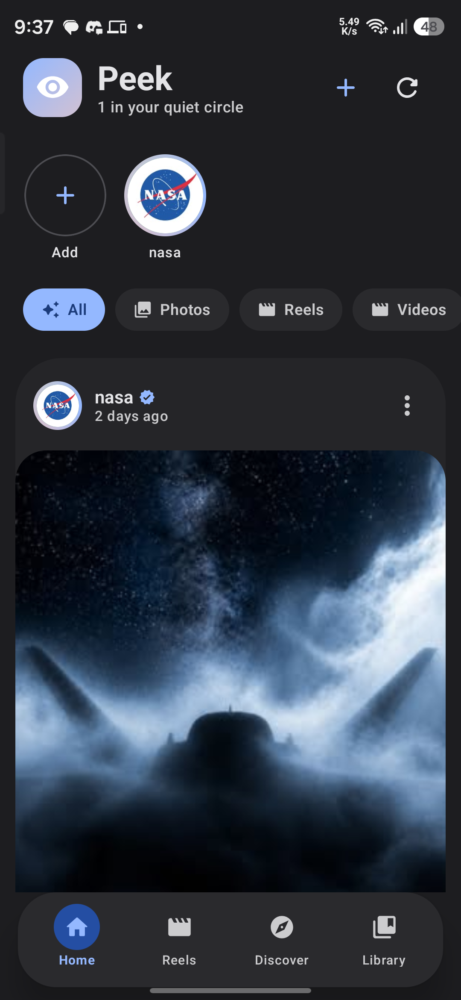
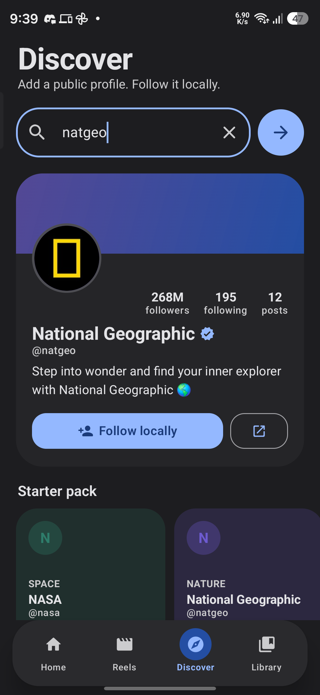
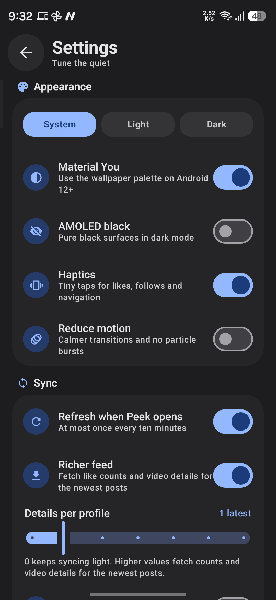

# Peek

**Instagram, without Instagram.**

Peek is a quiet, offline-first viewer for **public** Instagram profiles. Add a username or paste a link, follow that account **locally**, and see their posts and reels in a calm Material You interface. There is no Instagram login, no likes sent to Instagram, no algorithm and no feed suggestions.

> Peek is an unofficial client. It is not affiliated with Instagram or Meta. Only public pages are read. All media belongs to its respective owners.

## Why

Sometimes you just want to see what a few public accounts are sharing, without signing into an app designed to keep you scrolling. Peek keeps the serendipity out and the people in:

- Follow accounts **locally** — nothing is sent to Instagram
- Works **offline** with cached posts, bookmarks and downloads
- **Material You** dynamic colour, AMOLED black, five fallback palettes
- Thoughtful **haptics** and spring animations
- No account, no password, no tracking, no ads

## Features

### Following
- Add by username, `@handle`, or a full `instagram.com/...` link
- Local follow / unfollow, pin favourites to the top of your circle
- Starter pack of curated public accounts for a quick first run
- Optional searchable overview of everyone in your circle

### Home feed
- A quiet feed of the latest posts from accounts you follow
- Story-style avatar strip with unread rings
- Filters for **All / Photos / Reels / Videos**
- Double-tap to like with a particle heart burst and haptics
- Local likes, bookmarks and "save offline" downloads
- Pull to refresh; cached content opens instantly

### Profiles
- Full profile header with avatar, bio, links, stats and highlights
- Posts and Reels tabs, plus bookmarks saved from that profile
- Local saved state shown on the grid
- Share, copy, open on Instagram, pin, unfollow or remove a profile

### Posts & reels
- Full-screen post viewer with carousel paging
- Video playback with mute, play/pause and loop
- Reels tab with a vertically snapping player and action rail
- Double-tap like, comment jump, share, bookmark, download
- Caption, date, location, like count, comment count and audio

### Library
- **Saved** posts grid with filters
- **Offline** downloads manager with file sizes
- Backup export / import as a small JSON (follows, bookmarks, likes)
- Settings for theme, palette, haptics, motion, sync depth, Wi-Fi only, notifications and storage

### Under the hood
- Guest-access parsing of Instagram's server-rendered public pages
- Room database as the single source of truth
- WorkManager background sync with optional new-post notifications
- Coil image cache with stable cache keys, Media3 ExoPlayer video
- Offline banner and graceful handling of rate limits / private accounts

## Screenshots

<p align="center">
  
</p>

| Home | Discover |
| --- | --- |
|  |  |

| Profile | Reels |
| --- | --- |
|  |  |

| Post | Settings |
| --- | --- |
|  |  |

## Build

Requirements: Android Studio or a JDK 17 + Android SDK 36 setup.

```bash
git clone https://github.com/Avithegod2010/peek.git
cd peek
./gradlew :app:assembleDebug
```

The debug APK is written to `app/build/outputs/apk/debug/app-debug.apk`.

Minimum Android version: **8.0 (API 26)**. Material You dynamic colour is used on Android 12+; older devices get a hand-tuned fallback palette.

## How the guest reader works

Instagram’s public web pages server-render a small JSON payload inside `<script type="application/json" data-sjs>` tags. Peek requests the public profile page with normal browser hints, extracts that payload, and stores a normalized copy locally. A post page is read the same way when you open a post, which is where like counts, captions and video URLs come from.

This is deliberately **not** an authenticated scraper:

- No login, cookies or credentials
- No private accounts
- No posting, liking or commenting on Instagram
- Instagram can change the page shape or rate-limit guests at any time; Peek shows a clear message instead of failing silently
- The app is designed to remain useful with cached content when the network is unavailable

## Privacy

Following, likes, bookmarks, downloads and search history never leave the device. Peek has no analytics, no crash reporting and no server. Network requests go only to `instagram.com` / Instagram's CDN to read public pages.

## Project layout

```
app/src/main/java/com/avi/peek/
  data/remote/     guest HTTP client + SSR JSON parser
  data/local/      Room database and DataStore settings
  data/repo/       sync, caching, downloads and backups
  ui/              Compose Material You UI (screens, components, theme)
  work/            WorkManager sync worker and notifications
  util/            formatting, haptics, deep links, network monitoring
```

## Licence

MIT. See [LICENSE](LICENSE).
