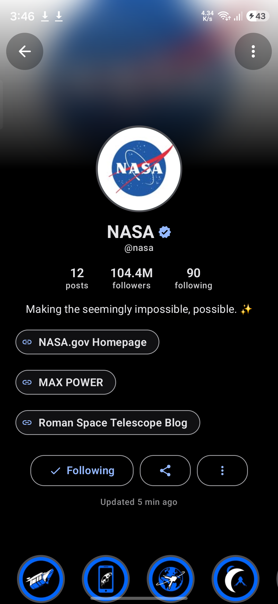
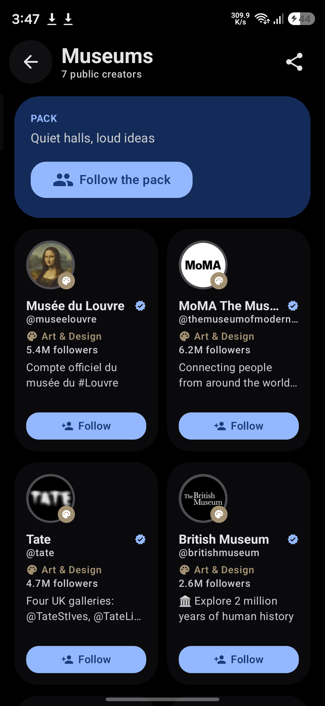
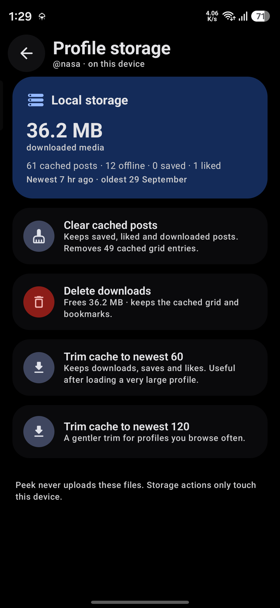
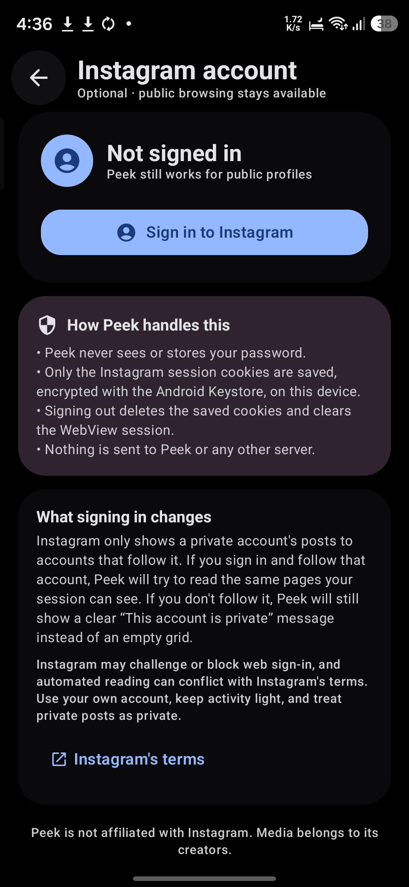

# Peek

**Instagram, without Instagram.**

Peek is a quiet, offline-first viewer for **public** Instagram profiles. Add a username or paste a link, follow that account **locally**, and see their posts and reels in a calm Material You interface. Public browsing needs no account. If you want to see private accounts you already follow, you can optionally connect your own Instagram web session in Settings. There are no likes sent to Instagram, no algorithm and no feed suggestions.

> Peek is an unofficial client. It is not affiliated with Instagram or Meta. Public pages are read by default; the optional signed-in mode reuses only your own Instagram session. All media belongs to its respective owners.

## Why

Sometimes you just want to see what a few public accounts are sharing, without signing into an app designed to keep you scrolling. Peek keeps the serendipity out and the people in:

- Follow accounts **locally** — nothing is sent to Instagram
- Works **offline** with cached posts, bookmarks and downloads
- **Material You** dynamic colour, AMOLED black, thirteen fallback palettes
- Thoughtful **haptics** and spring animations
- No Peek account, no tracking, no ads; an **optional** Instagram sign-in only for private accounts you follow

## Features

### Following
- Add by username, `@handle`, or a full `instagram.com/...` link
- **Global search by name** — look for “Cristiano Ronaldo” without knowing `@cristiano`
- Local follow / unfollow, pin favourites to the top of your circle
- Optional searchable overview of everyone in your circle

### Discover & Explore
- Curated **Starter pack** with real avatars, bios and follower counts loaded live
- **Explore popular creators** across Sport, Music, Film & TV, Tech, Nature, Art, Photography, Fashion, Food, Gaming, Travel, Business and Comedy
- Themed **packs** — Museums, Formula 1, Food, Architecture, Photography — plus a **Hidden gems** pack for smaller public accounts
- Import a shared pack from text or JSON; export any pack as a readable list plus a `peek://pack` link
- **Local suggestions** based on the categories you already follow
- Recently viewed profiles, recent searches and suggested names
- Material You category colours, animated cards and one-tap local follow
- Name search falls back to public web discovery; the profile itself is always read directly

### Search
- Search by **name**, `@handle`, or a pasted profile / post / reel link
- Resolve a post or reel link to its author without leaving the app
- **Filters** for category, verified accounts, follower range and country
- **Saved searches and aliases** — teach Peek that "CR7" means `@cristiano`
- **Offline search** across cached bios, usernames and captions
- Official-looking accounts are marked from their public verified badge, never guessed

### Home feed
- A quiet feed of the latest posts from accounts you follow
- Story-style avatar strip with unread rings and a count badge in the navigation bar
- Filters for **All / Photos / Reels / Videos**
- Double-tap to like with a particle heart burst and haptics
- Local liked feed, bookmarks and "save offline" downloads
- Pull to refresh; cached content opens instantly

### Profiles
- Full profile header with avatar, bio, links, stats and highlights
- Posts and Reels tabs, plus bookmarks saved from that profile
- **More like this** — related public creators from the same category, with local follow
- **See every public post** with automatic grid pagination and a “Load more posts” fallback
- **Search this profile** by caption, date or place, with media/date/sort filters
- **New since your last visit** count, “Show” filter and a local seen mark
- **Long-press to select** posts and save them offline, copy them to the gallery, archive them or add them to a collection
- **Download profile** in one action: Peek walks every public timeline page, then saves all posts offline, with an option to copy every photo and video into the device gallery
- **Download only new posts** without re-walking pages you already have
- **Profile storage** screen: see per-profile size and clear cache, delete downloads or trim to the newest 60/120 posts
- **Two-pane profile** on tablets: grid on the left, post detail on the right
- **Private circles / close friends** and combined local timelines
- **Read-only highlights** with the public cover and any media Instagram exposes
- Public/private state is re-checked on refresh and never inferred from an empty grid
- **Clear private-account state** — “This account is private” with a sign-in action, or an explanation that the signed-in session does not follow that account
- **Private profile diagnostics** — distinguishes signed out, expired session, not following, rate limit, network failure and hidden-by-panic-mode
- **Optional Instagram sign-in** in Settings for private accounts you already follow; passwords are never stored, only session cookies encrypted with the Android Keystore
- **Session health + guided reconnect** — expired cookies are detected and the profile offers a reconnect action
- **Session audit** — cookie names (never values), saved/verified/success timestamps and the recent request log
- **Manual session fallback** — paste your own `sessionid` when Instagram blocks the in-app login
- Local saved state shown on the grid
- Share, copy, open on Instagram, pin, unfollow or remove a profile
- Shared-element avatar transition from your Home circle into the profile header

### Posts & reels
- Full-screen post viewer with carousel paging and **swipe-down dismissal**
- **Pinch-to-zoom** photos with pan and double-tap reset
- Video playback with mute, play/pause, loop, **scrubbing**, **speed control** and a caption overlay
- **Picture-in-picture** from the Reels tab
- **Audio pages** for every cached reel: tap the audio line to see other posts using it
- Reels tab with a vertically snapping player and action rail
- Double-tap like, read-only comments sheet, share, bookmark, download
- **Save to gallery** from a post or from the Offline library; photos go to `Pictures/Peek/<username>`, videos to `Movies/Peek/<username>`
- **Read-only comments** with an Instagram session: author, avatar, text, date, like count and threaded replies, cached for offline reading and refreshed only when you ask
- **Story-style highlight and story viewer** with segmented progress, previous/next controls, local seen marks and a session-aware API fallback
- Caption, date, location, like count, comment count and audio

### Library
- **Saved** posts grid with filters
- **Liked** local feed and a **Weekly recap** with saved/downloaded/viewed counts
- **Collections** — private folders of saved posts with a cover and per-collection grid
- **Private circles** — local groups, close-friends labels and a combined cached timeline
- **Private feed** — a separate local timeline of posts from private accounts you follow
- **Panic mode** — hide private profiles, posts and downloads until biometric unlock; also available as a Quick Settings tile
- **Encrypted private vault** - private downloads are sealed with Android Keystore AES-GCM at rest, the data key is bound to biometric/device authentication, and the vault re-locks on a timer
- **Security center** - see session state, cookie names, on-device sizes, network destinations and recent request outcomes, then wipe private data or sign out in one place
- **Vault manager** - per-profile sealed sizes with open, seal and delete actions, plus passphrase-encrypted vault export/import
- **Private-feed upgrades** - search, media-type filters, sorting, circles, "new since last visit", multi-select downloads and collections
- **Private-safe downloads** — private media is never downloaded by default and never copied to the public gallery
- **Request budget** — hourly caps, quiet hours, exponential backoff and pause-on-rate-limit controls
- **Rate-limit dashboard** — recent profile/page/post outcomes, rate-limit count, pause-all downloads and background-sync control
- **Offline** downloads manager with file sizes and a **download queue** that can pause, resume, retry and remove carousel downloads
- **Download scheduler** settings: Wi-Fi only, charge-only, and a maximum newest-post count per profile
- **Per-profile storage manager** with cache clearing, download deletion and cache trimming
- **Passphrase-encrypted backups** (AES-256-GCM + PBKDF2), with legacy JSON restore
- **HTML and JSON archive export** of cached, saved and liked posts, plus per-profile and selected-post archives with incremental “only new since last export”
- **Gallery albums** under `Pictures/Peek/<username>` and `Movies/Peek/<username>`, with optional JSON caption/date sidecars
- Settings for theme, palette, custom accent hue/saturation/brightness/hex, text scale, high contrast, haptics, motion, sync depth, Wi-Fi only, charge-only downloads, notifications, cache limits, private auto-lock and storage
- **Backup/export privacy controls** - private content is excluded by default from backups and archives
- **Encrypted private backup v2** - private metadata and sealed vault files under a separate passphrase
- Biometric / device-lock app lock, a private-vault biometric gate and a one-handed Home search action
- App language picker for English, Hindi, Spanish, Portuguese, Arabic and Japanese, with RTL layouts
- Adaptive navigation rail on tablets and foldables, bottom bar on phones, and a two-pane profile on wide screens

### Under the hood
- Guest-access parsing of Instagram's server-rendered public pages
- Name discovery through a public web search, then direct public-profile reading
- Room database as the single source of truth; DataStore for settings, aliases and saved searches
- Field-level AES-GCM encryption for sensitive Room metadata through secure DAO decorators, so captions and URLs are never stored as plaintext
- Unit, instrumentation and CI checks for crypto round-trips, SSR parsing, migrations, secure DAOs, Compose surfaces and private access; see [docs/TESTING.md](docs/TESTING.md) for what needs a phone
- WorkManager background sync with optional new-post notifications
- Coil image cache with stable cache keys, Media3 ExoPlayer video
- Offline banner and graceful handling of rate limits / private accounts
- Material You motion: animated tab pills, shared elements, category transitions, press states and haptic feedback
- Home-screen widget, Quick Settings search tile, app shortcuts and an Instagram share target
- RTL-ready layouts, meaningful content descriptions and scalable typography

## Roadmap

A large, opinionated idea list lives in [IDEAS.md](IDEAS.md). Features that are intentionally partial: Instagram does not expose comment text to guests, so Peek shows the public count and a read-only hand-off; video captions fall back to the post caption because no subtitle track is published. The six supported languages cover navigation, settings, the security center, the vault and the private feed; the remaining screen copy is still English. A high-contrast runtime audit is still on the list.

## Screenshots

<p align="center">
  
</p>

| Home | Explore |
| --- | --- |
|  |  |

| Search by name | Profile |
| --- | --- |
|  |  |

| Reels | Post viewer |
| --- | --- |
|  |  |

| Library | Settings |
| --- | --- |
|  |  |

| Themed pack | Explore packs |
| --- | --- |
|  |  |

| Read-only highlight | Profile storage |
| --- | --- |
|  |  |

| Optional Instagram account |
| --- |
|  |

## Build

Requirements: Android Studio or a JDK 17 + Android SDK 36 setup.

```bash
git clone https://github.com/Avithegod2010/peek.git
cd peek
./gradlew :app:assembleDebug
```

The debug APK is written to `app/build/outputs/apk/debug/app-debug.apk`.

Release builds use a keystore that lives outside the repository. See [docs/RELEASE_SIGNING.md](docs/RELEASE_SIGNING.md) and run `./scripts/build-release.ps1 -Version <version>` to produce a signed, non-debuggable APK plus `SHA256SUMS.txt`. Never publish a debug APK as a production download.

Minimum Android version: **8.0 (API 26)**. Material You dynamic colour is used on Android 12+; older devices get a hand-tuned fallback palette.

### F-Droid

The repository includes F-Droid metadata in [`fdroid/com.avi.peek.yml`](fdroid/com.avi.peek.yml) and reproducible-build notes in [`docs/FDROID.md`](docs/FDROID.md). The app has no Google Play Services, Firebase, analytics or proprietary binaries.

## How the guest reader works

Instagram’s public web pages server-render a small JSON payload inside `<script type="application/json" data-sjs>` tags. Peek requests the public profile page with normal browser hints, extracts that payload, and stores a normalized copy locally. Older profile pages are loaded with the same anonymous Relay query the logged-out web profile uses for “Show more posts”. A post page is read the same way when you open a post, which is where like counts, captions and video URLs come from.

Public browsing is deliberately **not** authenticated:

- No login, cookies or credentials are required by default
- No private accounts are readable unless you choose to connect a session that follows them
- No posting, liking or commenting on Instagram
- Instagram can change the page shape or rate-limit guests at any time; Peek shows a clear message instead of failing silently
- The app is designed to remain useful with cached content when the network is unavailable

### Optional signed-in mode

Settings → Instagram account opens Instagram's own web login inside Peek. Peek never reads the password fields and never injects scripts into the page. When Instagram finishes signing in, the WebView's session cookies are encrypted with an Android Keystore AES-GCM key and saved in a separate local DataStore. On later launches the cookies are restored into Peek's HTTP client.

This mode is additive. It is used only to request private profiles your own session already follows, and it can be removed at any time with **Sign out**, which clears both the saved cookies and the WebView session. Instagram may still challenge or block web sign-in, and automated access can conflict with Instagram's terms. Peek does not promise that any particular private account will be readable.

## Privacy

Following, likes, bookmarks, downloads and local search history never leave the device. Peek has no analytics, no crash reporting and no Peek server. Profile and media requests go to `instagram.com` / Instagram's CDN. Name discovery sends the search phrase to DuckDuckGo's public HTML endpoint, and then reads the discovered Instagram profile directly. If you use the optional signed-in mode, your Instagram session cookies are encrypted locally with the Android Keystore and are never sent anywhere except Instagram itself.

## Security notes

- Android cloud/adb backup is disabled (`android:allowBackup="false"`) because Peek stores follows, saved posts and downloads locally.
- Private downloads are encrypted at rest with an Android Keystore AES-GCM vault. The vault key is bound to biometric/device authentication with a 30-minute auth window and is invalidated when biometrics are re-enrolled.
- Sensitive Room metadata (captions, profile text, media URLs, location, audio and local file paths) is field-level encrypted with a separate Android Keystore AES-GCM key. Comment text, search history and saved searches are encrypted too. Older plaintext rows are re-sealed on their next write.
- Metadata writes fail closed: Peek will not silently store plaintext if Keystore encryption is unavailable.
- The security center can rotate the metadata key; each ciphertext carries its key version so old rows stay readable during a partial rotation.
- API, image and video requests are restricted to Instagram, its CDN and DuckDuckGo; lookalike hosts, redirects and cleartext URLs are rejected.
- Private surfaces set `FLAG_SECURE` to block screenshots and recents thumbnails. Copied text is marked sensitive and cleared after one minute.
- Optional shake-to-hide locks private content without deleting anything.
- The download queue is persisted so pending posts return after a process death.
- The GitHub APK assets up to v1.4.0 are **debug builds** signed with the standard debug key. Releases from v1.5.0 onward are signed, non-debuggable release builds with published SHA-256 checksums; prefer those or an F-Droid build for production use.
- The repository contains no signing keystores, API keys, session cookies or account credentials.
- Name discovery sends the search phrase to DuckDuckGo's public HTML endpoint; profile and media requests go to Instagram. There is no Peek server.

## Downloads and fair use

- Peek now walks Instagram’s logged-out timeline pagination, so you can browse a public profile’s full public grid. Instagram can still stop pagination or rate-limit guests at any time.
- “Download profile” first loads every public page it can reach, then saves the posts it found. That can take a while and use several GB on large accounts.
- Mass downloading can trigger temporary rate limits or blocks. Peek keeps downloads to two at a time and shows failures instead of retrying aggressively.
- Photos and videos belong to their creators. Keep downloads private and do not redistribute them.
- A full profile can use significant storage and mobile data; the confirmation sheet and the existing Wi-Fi-only setting are there to keep that deliberate.

## Project layout

```
app/src/main/java/com/avi/peek/
  data/remote/     guest HTTP client + SSR JSON parser
  data/local/      Room database and DataStore settings
  data/repo/       sync, caching, downloads and backups
  ui/              Compose Material You UI (screens, components, theme)
  work/            WorkManager sync worker and notifications
  util/            formatting, haptics, deep links, network monitoring
```

## Licence

MIT. See [LICENSE](LICENSE).
